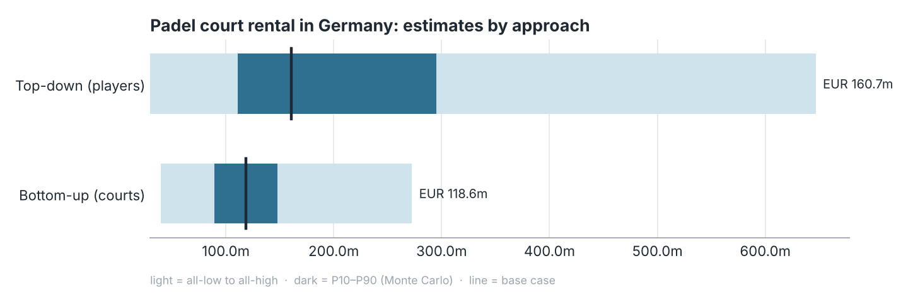

# 📐 market-sizing-kit

**Transparent market sizing the way strategy consultants do it.** Write your assumptions in a small YAML file and get:

- **TAM → SAM → SOM** with low / base / high cases
- **Triangulation**: top-down vs. bottom-up on a football-field chart
- **Tornado charts** showing which assumption moves the answer most (research that one first)
- **Monte Carlo ranges** (P10–P90), which are more realistic than "everything low × everything low"
- An **Excel model with live formulas**: change a yellow input cell and everything updates



## Why

A market size is only as good as its weakest assumption. In commercial due diligence, the number itself matters less than whether every driver is **explicit, ranged and sourced**, so someone can challenge it line by line. This kit enforces that structure and makes the sensitivities visible.

## Quick start

```bash
git clone https://github.com/vincentfreund/market-sizing-kit.git
cd market-sizing-kit
python -m venv .venv && source .venv/bin/activate     # Windows: .venv\Scripts\activate
pip install -e ".[dev]"

msk run cases/padel_germany.yaml        # → reports/padel_germany/{report.md, *.png, model.xlsx}
msk run cases/*.yaml                    # all cases
msk new ebike_rental_munich             # start your own from the template
pytest
```

## Writing a case

Every approach is a chain of drivers that **multiply**. Percentages are decimals.

```yaml
name: Specialty coffee in Munich
question: How large is the annual specialty-coffee revenue pool in Munich?
currency: EUR
primary: top_down                       # approach that defines the TAM

approaches:
  top_down:
    label: Top-down (consumers)
    drivers:
      - {name: Munich residents,                low: 1.50e+6, base: 1.55e+6, high: 1.60e+6, unit: people, source: "City statistics"}
      - {name: Share buying café coffee weekly, low: 0.30,    base: 0.40,    high: 0.50,    unit: "%",    source: "Survey X"}
      - ...
  bottom_up:
    label: Bottom-up (cafés)
    drivers:
      - {name: Specialty cafés in Munich,       low: 80,  base: 110, high: 150, unit: cafés,    source: "Google Maps count"}
      - {name: Coffees per café per day,        low: 150, base: 220, high: 300, unit: cups/day, source: "Observation"}
      - ...

funnel:
  sam: [{name: Share in Maxvorstadt, low: 0.08, base: 0.11, high: 0.14, unit: "%", source: "..."}]
  som: [{name: Share one café wins,  low: 0.02, base: 0.04, high: 0.06, unit: "%", source: "..."}]
```

## Example cases

| Case | Question | Structure |
|---|---|---|
| [`padel_germany`](cases/padel_germany.yaml) | Court-rental revenue pool for padel in Germany, and what a new 6-court club in Munich could win | players × hours × price **vs.** courts × hours × utilisation × price |
| [`specialty_coffee_munich`](cases/specialty_coffee_munich.yaml) | Specialty-coffee revenue in Munich, and what a new café in Maxvorstadt could win | consumers × frequency × share × price **vs.** cafés × cups/day × price |

> ⚠️ The example numbers are **illustrative placeholders**: every driver marked `assumption` still needs a real source. Replacing them is a good exercise. Use public statistics, count competitors on Google Maps, check menus and price lists, and stand outside a café for an hour.

## How it works

| Output | Method |
|---|---|
| Base / all-low / all-high | product of all drivers at that case |
| Tornado | swing one driver low → high while the others stay at base; sorted by swing |
| P10 / P50 / P90 | 20,000 draws, each driver ~ triangular(low, base, high), multiplied |
| Triangulation gap | highest ÷ lowest base estimate across approaches. Below 1.3× is robust; above 2× means something structural is off |
| Excel | same logic with `=PRODUCT()` formulas, so nothing is hard-coded |

## Project structure

```
cases/                 YAML cases (+ _template.yaml)
src/market_sizing/
  model.py             Driver, Approach, MarketCase, YAML loader
  analysis.py          tornado, Monte Carlo, triangulation
  charts.py            football field + tornado (matplotlib)
  excel.py             Excel export with live formulas
  report.py            Markdown report
  cli.py               `msk` command
tests/
```

## Roadmap

- [ ] Growth projection (CAGR per driver → market in 2030)
- [ ] Driver correlation in the Monte Carlo
- [ ] One-slide PDF summary export
- [ ] Streamlit front-end with sliders

## License

MIT
