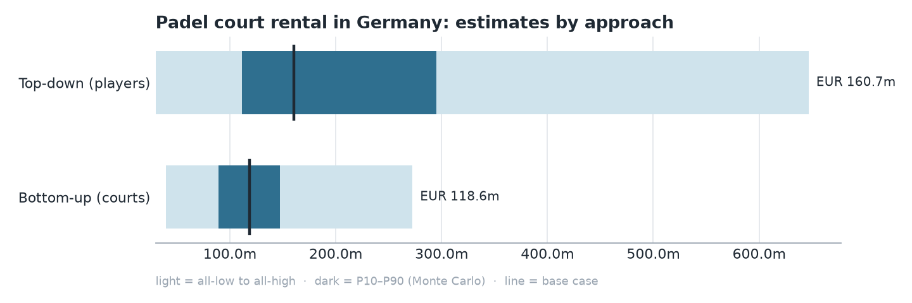
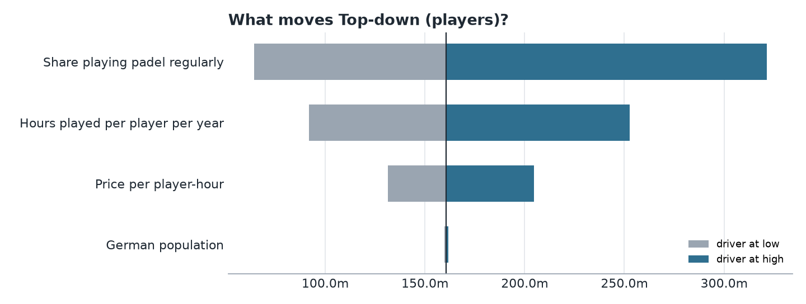
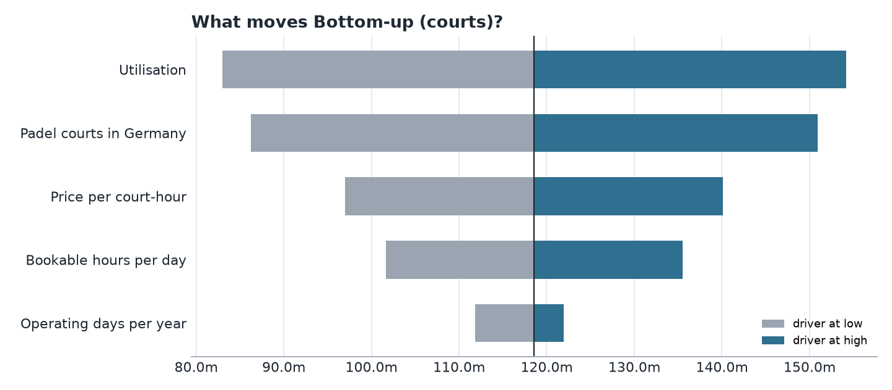

# Padel court rental in Germany

> **Question:** What is the annual court-rental revenue pool for padel in Germany, and what could one new 6-court club in Munich capture?

Currency: EUR · Year: 2026

⚠️ ILLUSTRATIVE NUMBERS. Every driver marked "assumption" is a placeholder chosen to make the example run. Replace each with a sourced figure (federation statistics, club websites, booking platforms, expert calls) before using the result anywhere. Scope: court rental only, excl. coaching, equipment, F&B and memberships. Prices incl. VAT.

## Answer

| | Low | **Base** | High |
|---|---:|---:|---:|
| TAM | EUR 39.9m | **EUR 118.6m** | EUR 272.6m |
| SAM | EUR 2.0m | **EUR 8.3m** | EUR 24.5m |
| SOM | EUR 99.8k | **EUR 664.0k** | EUR 2.9m |

TAM is taken from the primary approach (*Bottom-up (courts)*).

## Triangulation

| Approach | All-low | P10 | **Base** | P90 | All-high |
|---|---:|---:|---:|---:|---:|
| Top-down (players) | EUR 29.9m | EUR 111.3m | **EUR 160.7m** | EUR 295.3m | EUR 646.8m |
| Bottom-up (courts) | EUR 39.9m | EUR 89.5m | **EUR 118.6m** | EUR 147.6m | EUR 272.6m |

Highest / lowest base estimate: **1.36×** (acceptable, but worth reconciling).

## Top-down (players)

Formula: German population × Share playing padel regularly × Hours played per player per year × Price per player-hour

| Driver | Low | Base | High | Unit | Source |
|---|---:|---:|---:|---|---|
| German population | 83.0m | 83.5m | 84.0m | people | Destatis, approx. – verify latest |
| Share playing padel regularly | 0.2% | 0.5% | 1.0% | % | assumption |
| Hours played per player per year | 20 | 35 | 55 | h/yr | assumption (≈ every 1–2 weeks) |
| Price per player-hour | 9 | 11 | 14 | EUR | assumption (court-hour price ÷ 4 players) |

Biggest lever: **Share playing padel regularly**, which swings the result by EUR 257.2m (160% of base).

## Bottom-up (courts)

Formula: Padel courts in Germany × Bookable hours per day × Operating days per year × Utilisation × Price per court-hour

| Driver | Low | Base | High | Unit | Source |
|---|---:|---:|---:|---|---|
| Padel courts in Germany | 800 | 1,100 | 1,400 | courts | assumption – check federation / booking platforms |
| Bookable hours per day | 12 | 14 | 16 | h/day | assumption (opening hours) |
| Operating days per year | 330 | 350 | 360 | days | assumption |
| Utilisation | 35% | 50% | 65% | % | assumption – peak vs off-peak mix |
| Price per court-hour | 36 | 44 | 52 | EUR | assumption – check club websites |

Biggest lever: **Utilisation**, which swings the result by EUR 71.1m (60% of base).

## Funnel filters

**SAM** (serviceable share)

| Driver | Low | Base | High | Unit | Source |
|---|---:|---:|---:|---|---|
| Munich metro share of German demand | 5.0% | 7.0% | 9.0% | % | assumption – population share ≈ 7% |

**SOM** (obtainable share)

| Driver | Low | Base | High | Unit | Source |
|---|---:|---:|---:|---|---|
| Share a new 6-court club can win | 5.0% | 8.0% | 12% | % | assumption – depends on location & competition |

---
*Generated with [market-sizing-kit](../../README.md). The Excel model (`model.xlsx`) contains the same logic with live formulas.*