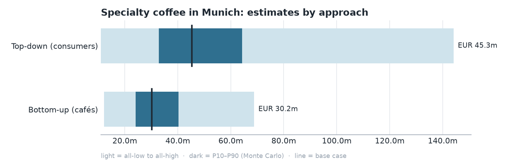
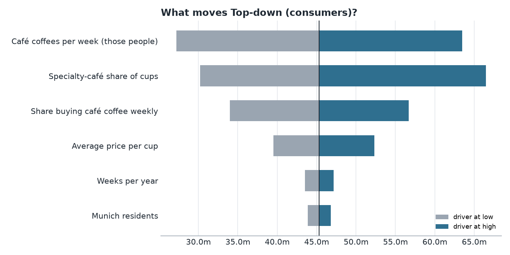
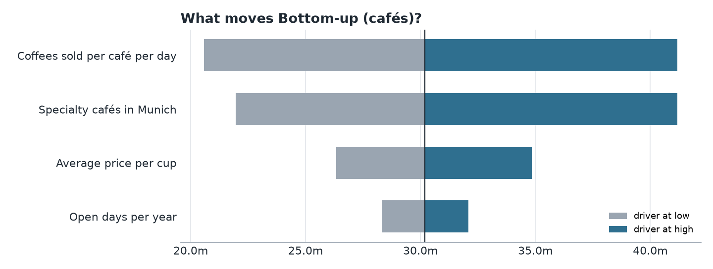

# Specialty coffee in Munich

> **Question:** How large is the annual specialty-coffee (café) revenue pool in Munich, and what could a new café in Maxvorstadt realistically win?

Currency: EUR · Year: 2026

⚠️ ILLUSTRATIVE NUMBERS. Drivers marked "assumption" are placeholders for the example – replace them with sourced figures before using the result. Scope: coffee drinks sold in independent specialty cafés, excl. food, chains, bakeries and at-home consumption. Classic case-interview structure.

## Answer

| | Low | **Base** | High |
|---|---:|---:|---:|
| TAM | EUR 11.0m | **EUR 45.3m** | EUR 144.1m |
| SAM | EUR 881.3k | **EUR 5.0m** | EUR 20.2m |
| SOM | EUR 17.6k | **EUR 199.5k** | EUR 1.2m |

TAM is taken from the primary approach (*Top-down (consumers)*).

## Triangulation

| Approach | All-low | P10 | **Base** | P90 | All-high |
|---|---:|---:|---:|---:|---:|
| Top-down (consumers) | EUR 11.0m | EUR 32.9m | **EUR 45.3m** | EUR 64.4m | EUR 144.1m |
| Bottom-up (cafés) | EUR 12.2m | EUR 24.1m | **EUR 30.2m** | EUR 40.2m | EUR 68.8m |

Highest / lowest base estimate: **1.50×** (acceptable, but worth reconciling).

## Top-down (consumers)

Formula: Munich residents × Share buying café coffee weekly × Café coffees per week (those people) × Weeks per year × Specialty-café share of cups × Average price per cup

| Driver | Low | Base | High | Unit | Source |
|---|---:|---:|---:|---|---|
| Munich residents | 1.5m | 1.6m | 1.6m | people | City of Munich statistics, approx. – verify |
| Share buying café coffee weekly | 30% | 40% | 50% | % | assumption |
| Café coffees per week (those people) | 1.5 | 2.5 | 3.5 | cups/wk | assumption |
| Weeks per year | 48 | 50 | 52 | weeks | assumption (holidays) |
| Specialty-café share of cups | 10% | 15% | 22% | % | assumption |
| Average price per cup | 3.4 | 3.9 | 4.5 | EUR | assumption – check 10 café menus |

Biggest lever: **Café coffees per week (those people)**, which swings the result by EUR 36.3m (80% of base).

## Bottom-up (cafés)

Formula: Specialty cafés in Munich × Coffees sold per café per day × Open days per year × Average price per cup

| Driver | Low | Base | High | Unit | Source |
|---|---:|---:|---:|---|---|
| Specialty cafés in Munich | 80 | 110 | 150 | cafés | assumption – count on Google Maps / guides |
| Coffees sold per café per day | 150 | 220 | 300 | cups/day | assumption – observe a queue for 1 hour |
| Open days per year | 300 | 320 | 340 | days | assumption |
| Average price per cup | 3.4 | 3.9 | 4.5 | EUR | assumption |

Biggest lever: **Coffees sold per café per day**, which swings the result by EUR 20.6m (68% of base).

## Funnel filters

**SAM** (serviceable share)

| Driver | Low | Base | High | Unit | Source |
|---|---:|---:|---:|---|---|
| Share of demand in Maxvorstadt & nearby | 8.0% | 11% | 14% | % | assumption – students + offices |

**SOM** (obtainable share)

| Driver | Low | Base | High | Unit | Source |
|---|---:|---:|---:|---|---|
| Share one new café can win | 2.0% | 4.0% | 6.0% | % | assumption |

---
*Generated with [market-sizing-kit](../../README.md). The Excel model (`model.xlsx`) contains the same logic with live formulas.*